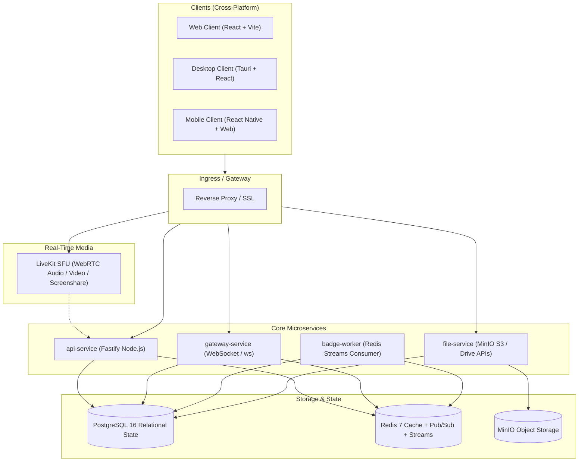

# Subspace Frequency - Master Architecture & Technical Specification

Subspace Frequency is a space-themed, self-hosted, Discord-like real-time communication platform built on a containerized microservices architecture with a clean, dark, rounded modern UI across Desktop, Mobile, and Web.

---

## 1. System Topology & Architecture

Subspace Frequency runs in Docker Compose across isolated services connected via an internal bridge network:



---

## 2. Monorepo Structure (Turborepo + pnpm)

```
subspace-frequency/
├── .github/                      # CI/CD workflows
├── apps/
│   ├── web/                      # React + Vite web client
│   ├── desktop/                  # Tauri application shell wrapping shared web app
│   ├── mobile/                   # React Native (Expo/Capacitor) mobile client
│   ├── api-service/              # Fastify HTTP API (Auth, Beacons, Relays, Admin)
│   ├── gateway-service/          # Real-time WebSocket gateway for Presence & Events
│   ├── file-service/             # MinIO S3 presigned URL generator & Vault drive
│   └── badge-worker/             # Redis Streams consumer awarding automated commendations
├── packages/
│   ├── database/                 # Drizzle ORM schemas, migrations, and database client
│   ├── constants/                # Space terminology, bitfield permissions, status enums
│   ├── crypto/                   # Passkeys (WebAuthn), Argon2id, Double Ratchet E2EE
│   ├── ui/                       # Shared dark-mode React / react-native-web UI components
│   └── test-utils/               # E2E test client fixtures and Docker test helpers
├── docker/
│   ├── Dockerfile.api
│   ├── Dockerfile.gateway
│   ├── Dockerfile.file
│   ├── Dockerfile.badge
│   └── livekit.yaml
├── docs/
│   ├── terminology.md            # Space terminology translation dictionary
│   ├── architecture.md           # Master architecture specification
│   └── roadmap.md                # Feature matrix, multi-phase roadmap & deliverables checklist
├── docker-compose.yml            # Primary local/production spin-up
├── docker-compose.test.yml       # Ephemeral test cluster for automated E2E tests
├── pnpm-workspace.yaml
└── turbo.json
```

---

## 3. Feature Specifications

### 3.1 Authentication & Security
- **Credentials**: Username + Argon2id hashed password.
- **Email Verification**: Toggleable instance setting (if SMTP is configured).
- **Two-Factor Authentication**: TOTP (Time-based One-Time Password with authenticator apps) + emergency backup codes.
- **Passkeys (FIDO2 / WebAuthn)**: Biometric and hardware key login via `@simplewebauthn`.
- **Instance Rules Acknowledgment**: Configurable short list of instance rules (TL;DR ToS) displayed on registration and on rule updates before access is granted.

### 3.2 Presence & Ghost Mode
- Five presence states: `online`, `idle`, `away`, `invisible`, `offline`.
- **Ghost Mode Security Rule**: If a Transmitter is `invisible`, the gateway strictly transforms this state to `offline` for all other users. No other client receives `invisible` event payloads under any circumstance.

### 3.3 Clearances & 64-Bit Bitfield Permissions
- **Bitfield Flags**: 64-bit integer bitmasks representing granular rights:
  - `VIEW_RELAY` (0x1)
  - `SEND_TRANSMISSIONS` (0x2)
  - `EMBED_LINKS` (0x4)
  - `ATTACH_FILES` (0x8)
  - `USE_SIGNAL_GLYPHS` (0x10)
  - `CONNECT_AUDIO` (0x20)
  - `SPEAK_AUDIO` (0x40)
  - `BROADCAST_HOLO_CAST` (0x80)
  - `MANAGE_TRANSMISSIONS` (0x100)
  - `MANAGE_RELAYS` (0x200)
  - `MANAGE_CLEARANCES` (0x400)
  - `KICK_MEMBERS` (0x800)
  - `BAN_MEMBERS` (0x1000)
  - `ADMINISTRATOR` (0x20000000)
- **Hierarchy Enforcement**: A Transmitter cannot kick, ban, mute, change nickname, or modify roles of any member holding an equal or higher clearance position. Clearances can be configured to allow promoting other roles.
- **Beacon Ownership**: The creator/owner has bypass authority over all Relays in that Beacon.
- **Relay Overwrites**: Specific Allow/Deny bitfields per Relay for clearances and individual Transmitters.

### 3.4 Relays (Channels) & Frequency Bands (Categories)
- **Relay Types**:
  - `text`: Synchronous text chat with 2000-character limit (configurable per instance).
  - `voice` (Comm-Link): Live audio/video with an embedded text chat (viewable without joining the voice call).
  - `forum` (Archival Relay): Structured asynchronous threads with tags.
  - `gallery` (Visual Relay): Media-first grid layout.
- **Channel Visibility & Reordering**:
  - Relays can be hidden from a user's channel list.
  - Dedicated "All Relays" tab.
  - Reordering requires "Display all channels" context menu toggle.
  - "Unhideable" flag settable by Beacon admins to keep critical relays visible to authorized users.

### 3.5 Comm-Link & Holo-Cast (Voice, Video, Screenshare)
- Powered by self-hosted **LiveKit SFU**.
- Real-time low-latency Opus audio, VP8/H.264 video, and high-framerate screensharing.
- Optional **LiveKit Native Quantum Encryption** using WebRTC Insertable Streams with shared participant session keys.

### 3.6 Direct Messaging & Affiliation (Friend) System
- **Affiliation Requests**: Friend requests supporting an optional attached message.
- **Transmission Requests**: Non-friends sharing a mutual Beacon can send 1 introductory transmission. Requests timeout after 7 days (at which point a new request can be sent). Once accepted, continuous DMs open until rescinded.
- **Subspace Meshes (Group DMs)**: Miniature ad-hoc servers without public clearances.
- **Quantum Encryption**: Instance-toggleable end-to-end encryption for 1-on-1 and Group DMs using Double Ratchet / Signal Protocol.

### 3.7 Subspace Vault (Drive & File Storage)
- **Self-Hosted MinIO Backend**: Presigned upload/download URLs directly to S3-compatible storage.
- **Storage Quota Management**: Tracked usage per Transmitter with drive view UI.
- **First-Time Upload Disclaimer**: Mandatory prompt warning that files uploaded are accessible to direct link holders and instance staff, advising against sensitive data.
- **External Cloud Storage (OneDrive, Google Drive, DropBox)**:
  - File picker modal via OAuth2 to link external files.
  - URL unfurling to render rich embedded previews in Relays without hosting files directly.

### 3.8 Commendations (Dynamic Badges)
- **Criteria Types**:
  - `ACCOUNT_AGE`: Milestone based on account creation timestamp.
  - `VOICE_MINUTES`: Accumulated duration in Comm-Link relays.
  - `SCREENSHARE_MINUTES`: Accumulated duration in Holo-Casts.
  - `TRANSMISSIONS_SENT`: Total message count.
  - `STAFF_CLEARANCE`: Mandatory instance staff badge.
  - `CUSTOM_CRITERIA`: Manually or event-assigned badges by Command Console staff.
- **Transmitter Controls**: Ability to reorder displayed commendations and toggle commendation visibility on their public profile.

### 3.9 Command Console (Admin & Moderation Dashboard)
- Staff rank hierarchy controlling access to the Command Console.
- Incident report resolution queue: view reported Beacons/Transmitters and inspect attached message evidence snippets.
- File vault inspector: browse, quarantine, or delete reported files.
- Transmitter and Beacon discovery moderation.

### 3.10 Discoverability & Global Search
- **Beacon Discovery**: Opt-in public directory for Beacons with distinct report mechanisms for inappropriate listings.
- **Global Quick Find (`Ctrl+K`)**: Rapid indexed search across Transmitters, Beacons, and Relays restricted strictly to entities the user belongs to.

---

## 4. UI/UX Design Standards

- **Theme**: Pure Dark Mode only (deep space obsidian, midnight navy, neon cyan/violet accents). No light mode.
- **Aesthetics**: Rounded cards, subtle border glows, modern clean typography.
- **Modals**: Centered popup dialogs with backdrop blur (`backdrop-filter: blur(8px)`) and darkened overlay.
- **Customizable Profiles**:
  - Banner color or uploaded image.
  - Display name font selector (short curated list of space/clean fonts).
  - Display name hex color picker with interactive color wheel.
  - Beacon-level font suppression toggle (Beacon can disable custom fonts in its members list).
  - Clearance colors override Transmitter display name colors in chat and member lists.

---

## 5. End-to-End Testing Strategy

- **Harness**: Docker Compose test runner running isolated Postgres, Redis, and MinIO databases.
- **Test Framework**: Vitest with supertest HTTP client and real WebSocket client connections.
- **Coverage Goal**: 100% of REST endpoints, WebSocket event dispatches, clearance bitfield computations, hierarchy boundary enforcement, and time-out invalidations.
