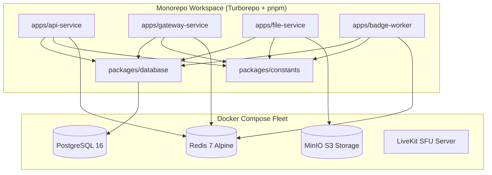

# Phase 1: Monorepo Foundation & Microservices Core

## 1. Overview & Objective
Phase 1 establishes the bedrock of Subspace Frequency. The goal is to set up a clean, high-performance monorepo using Turborepo and pnpm workspaces, define the core Docker Compose container fleet (Postgres 16, Redis 7, MinIO, LiveKit, and Node.js microservices), establish our Drizzle ORM schemas, define domain constants and bitfield permissions, and launch an automated Vitest end-to-end test harness.

---

## 2. Architectural Blueprint



---

## 3. Detailed Component Specifications

### 3.1 Monorepo & Build Orchestration
- **pnpm workspaces**: Declares `apps/*` and `packages/*`. Fast, hardlink-based node_modules isolation avoiding phantom dependencies.
- **Turborepo (`turbo.json`)**: Configures task pipeline (`build`, `dev`, `lint`, `test`, `test:e2e`) with intelligent hashing, caching, and parallel execution.
- **Root TypeScript Config (`tsconfig.base.json`)**: Shared strict TypeScript compiler configuration extended across all internal packages and microservices.

### 3.2 Docker Multi-Container Fleet & Port Security (`docker-compose.yml`)
- **Port Security Policy**: For security, no unnecessary ports are exposed or published outside of Docker. Internal services (`postgres`, `redis`, `minio`, `badge-worker`) communicate exclusively over the internal bridge network (`subspace_net`). Only client-facing gateways / reverse proxies publish external ports.
- **Remote Host Environment**: Code is synchronized to `root@192.168.1.9` in `/mnt/data2/sf-2026/` where Docker Compose test suites execute.
1. **`postgres`**: PostgreSQL 16 Alpine on internal `subspace_net` (no host port published in production).
   - Healthcheck: `pg_isready -U subspace -d subspace_frequency`
   - Volume: `postgres_data`
2. **`redis`**: Redis 7 Alpine on internal `subspace_net` (no host port published in production).
   - Healthcheck: `redis-cli ping`
   - Volume: `redis_data`
3. **`minio`**: Self-hosted S3-compatible object storage on internal `subspace_net`.
   - Volume: `minio_data`
4. **`livekit`**: LiveKit SFU real-time server for Comm-Link audio/video/screenshare streams.
   - Ports: `7880` (HTTP/WebSocket signaling), `7881` (TCP media fallback), `50000-50100/udp` (WebRTC media)
5. **`api-service`**: Fastify REST HTTP server on port `3001`.
6. **`gateway-service`**: Real-time WebSocket connection engine on port `3002`.
7. **`file-service`**: Subspace Vault presigned URL and storage proxy on port `3003`.
8. **`badge-worker`**: Redis Streams background consumer for automated commendation evaluation.

### 3.3 Shared Packages
1. **`packages/constants`**:
   - Canonical terminology constants mapping UI and domain terms (`TRANSMITTER`, `TRANSMISSION`, `BEACON`, `RELAY`, `CLEARANCES`, etc.).
   - 64-bit Bitfield permission flags (`PERMISSIONS.VIEW_RELAYS`, `PERMISSIONS.SEND_TRANSMISSIONS`, `PERMISSIONS.ADMINISTRATOR`, etc.).
   - Presence statuses (`online`, `idle`, `away`, `invisible`, `offline`).
   - Relay types (`text`, `comm_link`, `archival`, `visual`).
2. **`packages/database`**:
   - Drizzle ORM schema models:
     - `transmitters`: Core account identity, Argon2id hash, display metadata, presence.
     - `beacons`: Server entities, ownership, public discovery status, rules text.
     - `clearances`: Roles, hierarchy levels, bitfield permission integers, color hex.
     - `beacon_members`: Join table linking transmitters, beacons, nicknames, clearances.
     - `relays`: Communication channels, type enums, category headers, unhideable flag.
     - `relay_overwrites`: Specific clearance/transmitter allow/deny permission masks.
     - `transmissions`: Synchronous text/media messages, 2000-char limits.
     - `commendations`: Badge definitions, trigger criteria, threshold numbers.
     - `transmitter_commendations`: Earned badges, display order, visibility boolean.
     - `vault_files`: Stored files, S3 storage keys, MIME types, owner IDs.
   - Drizzle migration runner and seed generators.

### 3.4 Service Baseline Scaffolds
- Each service has a dedicated `src/index.ts`, `Dockerfile`, and health check endpoint:
  - `api-service`: Fastify app exposing `GET /health` responding with `{ status: "ok", db: "connected", redis: "connected" }`.
  - `gateway-service`: WebSocket server validating client connections and Redis Pub/Sub connectivity.
  - `file-service`: Storage controller validating MinIO S3 bucket availability.
  - `badge-worker`: Stream consumer registering consumer groups in Redis Streams.

---

## 4. Deliverables Matrix

| Deliverable | Description | File Path |
| :--- | :--- | :--- |
| **Workspace Manifest** | pnpm workspace definition | `pnpm-workspace.yaml` |
| **Turbo Pipeline** | Turborepo configuration | `turbo.json` |
| **Root Package** | Monorepo root scripts & dev dependencies | `package.json` |
| **Base TSConfig** | Shared strict TypeScript configuration | `tsconfig.base.json` |
| **Docker Compose** | Production/Dev multi-container fleet | `docker-compose.yml` |
| **Test Compose** | Ephemeral container cluster for automated tests | `docker-compose.test.yml` |
| **LiveKit Config** | SFU server configuration template | `docker/livekit.yaml` |
| **Constants Package** | Permissions, terminology, status constants | `packages/constants/src/index.ts` |
| **Database Package** | Drizzle ORM schemas, client connection, migrations | `packages/database/src/index.ts` |
| **API Service** | Fastify REST API baseline with health check | `apps/api-service/src/index.ts` |
| **Gateway Service** | WebSocket server baseline | `apps/gateway-service/src/index.ts` |
| **File Service** | Storage controller baseline | `apps/file-service/src/index.ts` |
| **Badge Worker** | Redis Streams consumer baseline | `apps/badge-worker/src/index.ts` |

---

## 5. Verification & Acceptance Criteria

### Automated Verification
1. **Type Checking & Build**:
   ```bash
   pnpm build
   ```
   All packages (`constants`, `database`) and apps (`api-service`, `gateway-service`, `file-service`, `badge-worker`) compile with zero TypeScript errors under strict mode.

2. **Drizzle Migration Check**:
   ```bash
   pnpm --filter @subspace/database db:generate
   ```
   Migrations generate successfully from Drizzle schema definitions without syntax errors or unresolved foreign key conflicts.

3. **Automated Dockerized Test Run**:
   ```bash
   docker compose -f docker-compose.test.yml up --abort-on-container-exit --exit-code-from test-runner
   ```
   Test container boots, connects to PostgreSQL and Redis, executes schema migrations, tests base health endpoints, and exits with code `0`.

### Manual Acceptance Verification
1. Run `docker compose up -d`.
2. Verify all containers are in `healthy` status:
   - `docker compose ps`
3. Verify HTTP health endpoints:
   - `curl http://localhost:3001/health` $\to$ returns HTTP 200 with `{ status: "ok" }`.
   - `curl http://localhost:7880` $\to$ LiveKit SFU responds.
   - `http://localhost:9001` $\to$ MinIO console loads.
4. Tear down:
   - `docker compose down -v` cleanly cleans up all networks and volumes.
