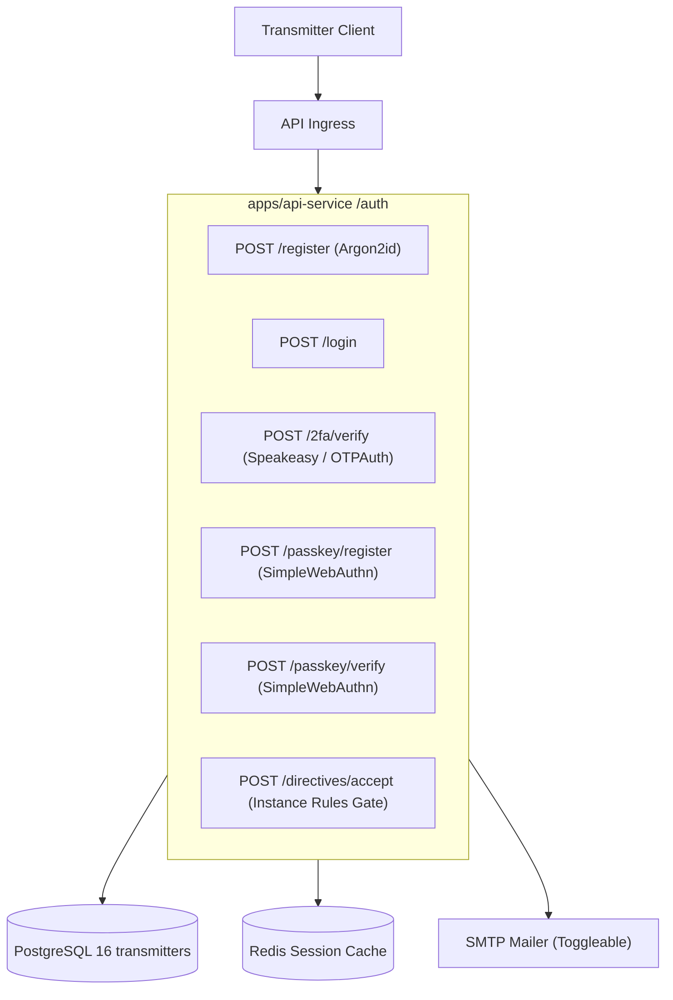

# Phase 2: Authentication, Security, 2FA & Passkeys

## 1. Overview & Objective
Phase 2 implements the security and identity backbone of Subspace Frequency. It delivers resilient transmitter registration and authentication with Argon2id password hashing, time-based one-time password (TOTP) two-factor authentication, biometric/hardware FIDO2 passkeys via SimpleWebAuthn, optional SMTP email verification, and the mandatory instance rules agreement modal gate.

---

## 2. Architectural Blueprint

---

## 3. Detailed Component Specifications

### 3.1 Transmitter Identity & Credentials
- **Password Security**: Passwords hashed using Argon2id with recommended memory and parallelism parameters.
- **Session Tokens**: Cryptographically signed JWTs with short expiry + refresh token rotation stored in Redis.
- **Email Verification (Toggleable)**: If instance configuration has SMTP enabled, a verification code is dispatched; if disabled, account is verified on creation.

### 3.2 Two-Factor Authentication (2FA)
- TOTP implementation compatible with standard authenticator apps (Google Authenticator, Aegis, 1Password).
- QR code generation endpoint providing `otpauth://` URI.
- Generation of 10 cryptographically random, hashed single-use emergency backup recovery codes.

### 3.3 Passkeys (FIDO2 / WebAuthn)
- Using `@simplewebauthn/server` and `@simplewebauthn/browser`.
- Registration challenge endpoint (`POST /auth/passkey/register-challenge`).
- Verification endpoint (`POST /auth/passkey/register-verify`) saving credential ID, public key, and counter in DB.
- Passwordless authentication flow: client signs server challenge; server verifies signature against stored public key.

### 3.4 Subspace Directives Gate (Instance Rules Acknowledgment)
- Configurable list of instance rules (TL;DR ToS) configured in instance settings.
- Transmitters track `last_agreed_rules_version`.
- If `instance_rules_version > transmitter.last_agreed_rules_version`, all protected API routes (except rules viewing and acceptance) return `403 DIRECTIVES_UPDATE_REQUIRED`.

---

## 4. Deliverables Matrix

| Deliverable | Description | File Path |
| :--- | :--- | :--- |
| **Crypto Utilities** | Argon2id, TOTP, and Passkey verification utilities | `packages/crypto/src/index.ts` |
| **Transmitter Auth Schemas** | DB schema for passkeys, 2FA secrets, backup codes, rules version | `packages/database/src/schema/transmitters.ts` |
| **Auth Routes** | Register, login, refresh, logout | `apps/api-service/src/modules/auth/auth.routes.ts` |
| **2FA Module** | TOTP setup, verify, backup codes redemption | `apps/api-service/src/modules/auth/2fa.ts` |
| **Passkey Module** | SimpleWebAuthn challenge generation & verification | `apps/api-service/src/modules/auth/passkeys.ts` |
| **Directives Middleware** | Rules version gate blocking unacknowledged users | `apps/api-service/src/middleware/directives.ts` |

---

## 5. Verification & Acceptance Criteria

### Automated Verification
1. **Unit & Integration Tests**:
   - Argon2id hash & verify matches expected security params.
   - TOTP validation tests (valid token succeeds, expired token fails, backup code consumes once).
   - Passkey challenge flow simulated using WebAuthn testing fixtures.
2. **E2E API Test Suite**:
   - Register transmitter $\to$ Login with password $\to$ Receive JWT.
   - Enable 2FA $\to$ Require 2FA code on subsequent login $\to$ Test emergency recovery code fallback.
   - Update instance rules version $\to$ Verify API blocks requests until `POST /auth/directives/accept` is called.

### Manual Acceptance Verification
1. Register user via API with Postman or Curl.
2. Register passkey and verify passwordless login completes.
3. Test rules update prompt triggers in API response.
