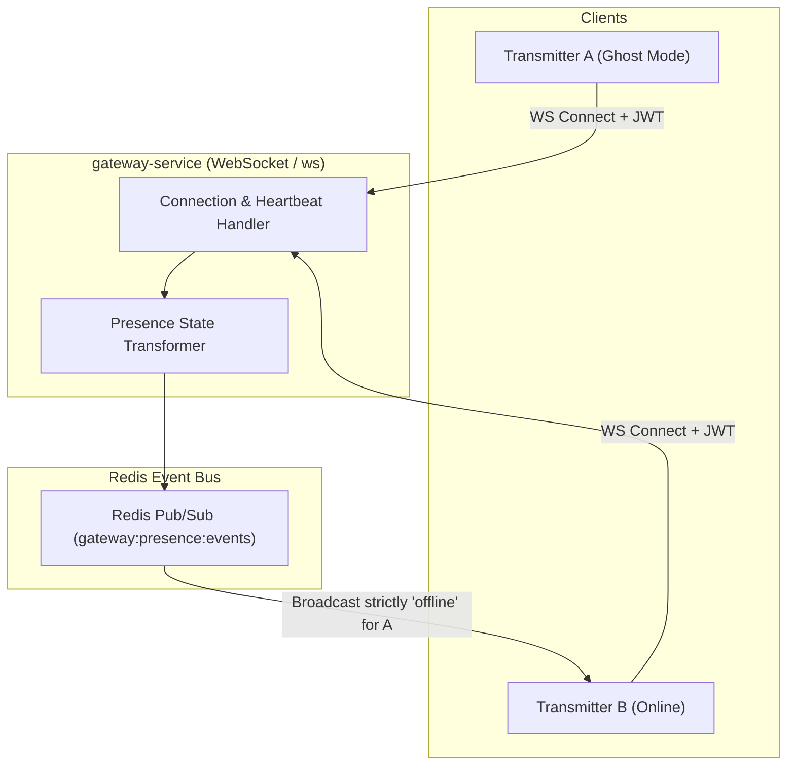

# Phase 3: Real-Time WebSocket Gateway & Ghost Mode Presence

## 1. Overview & Objective
Phase 3 establishes the persistent real-time communication pipeline of Subspace Frequency. It delivers the WebSocket gateway engine (`gateway-service`), connection heartbeat lifecycle, multi-instance horizontal scaling via Redis Pub/Sub, and the presence tracking subsystem featuring the **Ghost Mode** stealth security engine.

---

## 2. Architectural Blueprint

---

## 3. Detailed Component Specifications

### 3.1 WebSocket Connection Lifecycle
- **Handshake & Auth**: WebSocket connection requires ticket/JWT in initial query string or first frame `IDENTIFY` payload within 5 seconds; unauthenticated connections are forcefully severed.
- **Heartbeat & Keep-Alive**: Client sends `PING` every 30 seconds; server replies with `PONG`. Missing 2 consecutive heartbeats drops the socket.
- **Session Resumption**: Client passes `session_id` and last received sequence number on reconnect to receive missed events from Redis Stream buffer.

### 3.2 Presence States & Ghost Mode Security
- Five distinct presence states:
  1. `online`: Active and interacting.
  2. `idle`: Inactive for > 5 minutes.
  3. `away`: Explicitly marked away.
  4. `invisible`: **Ghost Mode** (stealth browsing).
  5. `offline`: Disconnected.
- **Ghost Mode Guarantee**:
  - The Gateway presence engine intercepts state updates before emission.
  - If a Transmitter switches to `invisible`, the server broadcasts an event payload containing status: `"offline"` to all friends and mutual beacon members.
  - The actual `"invisible"` status is strictly echoed back ONLY to the requesting transmitter's personal socket. Under no circumstance does the string `"invisible"` appear in external broadcasts.

### 3.3 Multi-Node Gateway Sync
- Uses Redis Pub/Sub so multiple instances of `gateway-service` can run in Docker / Kubernetes.
- Presence hashes are maintained in Redis with automatic TTL expiry refreshed by WebSocket pings.

---

## 4. Deliverables Matrix

| Deliverable | Description | File Path |
| :--- | :--- | :--- |
| **Gateway Server** | WebSocket connection router and message parser | `apps/gateway-service/src/server.ts` |
| **Heartbeat Handler** | Ping/Pong and socket timeout watchdog | `apps/gateway-service/src/heartbeat.ts` |
| **Presence Engine** | State tracker and Ghost Mode transformer | `apps/gateway-service/src/presence.ts` |
| **Redis Event Bus** | Inter-node Pub/Sub presence broadcast adapter | `apps/gateway-service/src/bus.ts` |
| **Gateway Protocols** | Shared WebSocket payload opcode and event typings | `packages/constants/src/gateway.ts` |

---

## 5. Verification & Acceptance Criteria

### Automated Verification
1. **Connection Lifecycle Tests**:
   - Client identifies with valid token $\to$ receives `READY` payload with sequence ID.
   - Client identifies with invalid/expired token $\to$ socket disconnected with code `4001`.
   - Client stops sending heartbeats $\to$ server terminates socket after timeout.
2. **Ghost Mode E2E Test**:
   - Spin up Client A and Client B connected to Gateway.
   - Client A updates presence to `"invisible"`.
   - Assert Client A receives confirmation `{ status: "invisible" }`.
   - Assert Client B receives event `{ user_id: A.id, status: "offline" }`.

### Manual Acceptance Verification
- Connect via WebSocket client tool (e.g. websocat), verify heartbeats, change status to invisible, and inspect events received by a secondary client.
