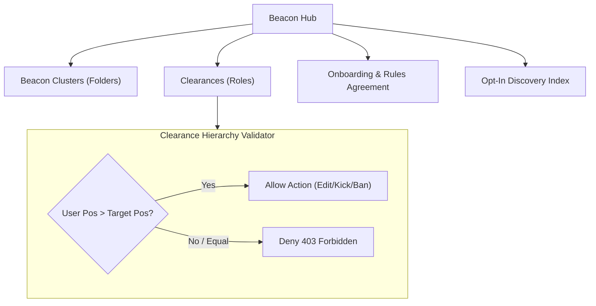

# Phase 4: Beacons, Beacon Clusters & Clearances

## 1. Overview & Objective
Phase 4 implements the community core of Subspace Frequency. It delivers Beacons (logical servers), Beacon Clusters (folders in the beacon navigation list), 64-bit Bitfield Clearances (roles with granular permissions), strict clearance hierarchy rules, Beacon onboarding with mandatory rules acceptance, and opt-in Beacon discovery.

---

## 2. Architectural Blueprint

---

## 3. Detailed Component Specifications

### 3.1 Beacons & Beacon Clusters
- **Beacon Hub**: Logical community entity with name, description, avatar icon, header banner, owner ID, and discovery flag.
- **Beacon Clusters**: User-specific grouping folders on the Beacon List allowing transmitters to organize Beacons by dragging or editing folder properties.
- **Beacon Owner Privilege**: The Beacon owner automatically bypasses all relay permission checks.

### 3.2 64-Bit Bitfield Clearances (Roles & Permissions)
- **Permissions Bitfield**: Represented as a 64-bit integer (`BigInt`) supporting high-speed bitwise operations (`&`, `|`, `~`).
  - Bit flags: `VIEW_RELAY` (0x1), `SEND_TRANSMISSIONS` (0x2), `EMBED_LINKS` (0x4), `ATTACH_FILES` (0x8), `USE_SIGNAL_GLYPHS` (0x10), `CONNECT_AUDIO` (0x20), `SPEAK_AUDIO` (0x40), `BROADCAST_HOLO_CAST` (0x80), `MANAGE_TRANSMISSIONS` (0x100), `MANAGE_RELAYS` (0x200), `MANAGE_CLEARANCES` (0x400), `KICK_MEMBERS` (0x800), `BAN_MEMBERS` (0x1000), `ADMINISTRATOR` (0x20000000).
- **Clearance Delegation**: Clearances can be flagged to permit members to grant specific lower clearances to others.
- **Visual Presentation**:
  - Clearance color overrides user display name color in chat and member list.
  - Beacon-level toggle: Beacon admins can disable custom fonts in display names to preserve visual readability.

### 3.3 Strict Clearance Hierarchy Rules
- Every clearance has an integer `position` (0 is `@everyone`, higher numbers denote higher authority).
- A transmitter's effective hierarchy rank is `MAX(roles.position)`.
- **Enforcement Protocol**: A user **cannot** edit, assign, revoke, kick, ban, change nickname of, or delete transmissions created by a member whose highest clearance is equal to or greater than their own.

### 3.4 Beacon Onboarding & Rules Acceptance
- New members enter an onboarding state where they must review Beacon rules and click agree before gaining access to general relays.
- Option to select initial opt-in roles during onboarding.

### 3.5 Beacon Discovery Index
- Beacons can toggle `is_discoverable: true` to list in the public index.
- Separate abuse reporting queue for reported discoverable Beacons.

---

## 4. Deliverables Matrix

| Deliverable | Description | File Path |
| :--- | :--- | :--- |
| **Beacon Schemas** | DB models for beacons, clusters, members, clearances | `packages/database/src/schema/beacons.ts` |
| **Bitfield Constants** | 64-bit permission flags and bitwise calculators | `packages/constants/src/permissions.ts` |
| **Beacon API Routes** | CRUD for beacons, members, icon uploads | `apps/api-service/src/modules/beacons/beacons.routes.ts` |
| **Clearance API Routes**| Create, update, reorder roles, color definitions | `apps/api-service/src/modules/clearances/clearances.routes.ts` |
| **Hierarchy Guard** | Middleware enforcing rank boundaries on user operations | `apps/api-service/src/middleware/hierarchy.ts` |
| **Onboarding Engine** | Rules agreement state machine and role self-assignment | `apps/api-service/src/modules/onboarding/onboarding.routes.ts` |

---

## 5. Verification & Acceptance Criteria

### Automated Verification
1. **Bitfield Calculation Tests**:
   - Verify bitwise OR combines multiple permissions.
   - Verify bitwise AND checks for specific permissions.
   - Verify `ADMINISTRATOR` flag grants all permissions implicitly.
2. **Hierarchy Rule Enforcement Tests**:
   - User A (rank 5) attempts to kick User B (rank 6) $\to$ returns `403 FORBIDDEN_HIERARCHY`.
   - User A (rank 5) attempts to kick User C (rank 5) $\to$ returns `403 FORBIDDEN_HIERARCHY`.
   - User A (rank 5) kicks User D (rank 4) $\to$ succeeds.
3. **Onboarding Gate Tests**:
   - Joining member cannot send transmissions until `POST /beacons/:id/onboarding/complete` is executed.

### Manual Acceptance Verification
- Create a Beacon, configure 3 clearance tiers, assign members, verify that role colors display properly, and confirm hierarchy limits in API responses.
