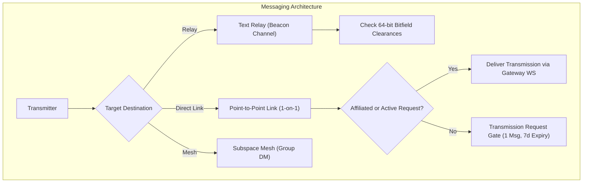

# Phase 5: Text Relays & Direct Messaging (P2P / Mesh)

## 1. Overview & Objective
Phase 5 implements the transmission exchange systems of Subspace Frequency. It delivers standard Text Relays with a 2000-character limit, Point-to-Point Links (1-on-1 DMs), Subspace Meshes (Group DMs), Affiliation Requests with introductory notes, Transmission Requests with 7-day timeouts, and comprehensive blocking (Signal Blacklist).

---

## 2. Architectural Blueprint

---

## 3. Detailed Component Specifications

### 3.1 Text Relays & Transmissions
- **2000-Character Limit**: Default limit per transmission, instance configurable via ENV/JSON.
- **Relay Overwrites**: Allow and Deny 64-bit bitmasks applied per Relay for clearances and individual transmitters.
- **Transmission Features**: Markdown formatting, mentions (`@transmitter`, `@role`), signal glyphs (custom emojis), and file attachments.

### 3.2 Point-to-Point Links & Subspace Meshes
- **Point-to-Point Link**: 1-on-1 direct messaging channel created on demand.
- **Subspace Mesh**: Group DM supporting up to 10 Transmitters without requiring a Beacon. Meshes support custom names and group icons.

### 3.3 Transmission Requests & Affiliation Requests
- **Transmission Request Gate**:
  - Non-affiliated transmitters sharing a mutual Beacon can send **exactly 1** introductory transmission to a user who has message requests enabled.
  - The recipient can Accept or Decline.
  - Requests automatically time out after **7 days** if unaccepted; once timed out, the sender can attempt a new request.
  - Accepted requests do not time out, but either user can rescind acceptance at any time.
- **Affiliation Requests (Friends)**:
  - Supports an optional attached greeting note when sending the request.

### 3.4 Signal Blacklist (Blocking System)
- Three tiers of blocking:
  1. Transmitter block (prevents DMs, hides transmissions in mutual relays).
  2. Transmission block (hides specific transmissions).
  3. Beacon block (prevents receiving invites from or seeing content from an entire Beacon).

---

## 4. Deliverables Matrix

| Deliverable | Description | File Path |
| :--- | :--- | :--- |
| **Transmission Schemas** | DB models for transmissions, direct links, meshes, requests | `packages/database/src/schema/transmissions.ts` |
| **Relay Chat API** | Send, edit, delete, list transmissions with pagination | `apps/api-service/src/modules/transmissions/transmissions.routes.ts` |
| **Requests Module** | Transmission request lifecycle (1 message, 7d timeout) | `apps/api-service/src/modules/requests/requests.routes.ts` |
| **Affiliations Module**| Friend requests with custom greeting notes | `apps/api-service/src/modules/affiliations/affiliations.routes.ts` |
| **Block Engine** | Transmitter, message, and beacon blocking logic | `apps/api-service/src/modules/blocks/blocks.routes.ts` |

---

## 5. Verification & Acceptance Criteria

### Automated Verification
1. **Transmission Length Tests**:
   - Transmissions of 2000 characters succeed; 2001 characters return `400 TRANSMISSION_EXCEEDS_LENGTH`.
2. **Transmission Request Gate Tests**:
   - Non-friends sharing a Beacon send 1st message $\to$ succeeds.
   - Non-friends attempt 2nd message before acceptance $\to$ returns `403 TRANSMISSION_REQUEST_PENDING`.
   - Fast-forward clock 8 days $\to$ request expires $\to$ sender is permitted to initiate a new request.
   - Non-friends not sharing a Beacon $\to$ returns `403 NO_SHARED_BEACON`.
3. **Affiliation Note Tests**:
   - Create affiliation request with 200-char note $\to$ recipient receives note in request payload.

### Manual Acceptance Verification
- Open two browser tabs, exchange transmissions in a Text Relay, test editing and deleting transmissions, and verify real-time arrival over the Gateway WebSocket.
