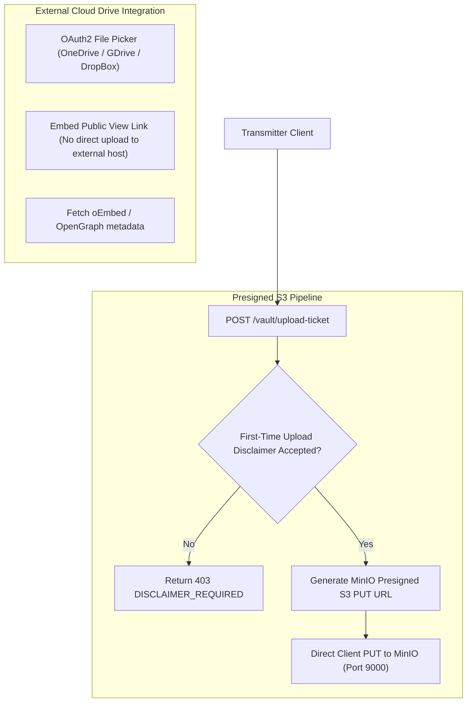

# Phase 6: Subspace Vault (Storage) & Cloud Integrations

## 1. Overview & Objective
Phase 6 establishes the personal storage drive and attachment infrastructure of Subspace Frequency. It delivers the **Subspace Vault** for file management, MinIO S3 presigned upload/download pipelines, the mandatory first-time upload disclaimer, external cloud drive tethers (OneDrive, Google Drive, Dropbox), and rich inline URL unfurling.

---

## 2. Architectural Blueprint

---

## 3. Detailed Component Specifications

### 3.1 MinIO S3 & Presigned Upload Pipelines
- **Direct S3 Upload**: Client requests an upload ticket from `file-service`; server generates a presigned S3 `PUT` URL with a 15-minute expiry.
- **Quota Tracking**: Storage usage is tracked per transmitter in PostgreSQL. If the transmitter exceeds their instance quota, further uploads are blocked.

### 3.2 First-Time Upload Disclaimer Gate
- Before any file upload ticket can be issued, the server verifies `transmitter.has_accepted_upload_disclaimer`.
- If `false`, the client receives a mandatory warning modal:
  > *"Files uploaded to Subspace Frequency are accessible to anyone with the direct link (with or without an account). Instance staff will always have access to review all files. Do not upload sensitive, confidential, or private material."*
- User must explicitly acknowledge the disclaimer before `has_accepted_upload_disclaimer` is set to `true`.

### 3.3 External Cloud Drive Tethers (OneDrive, Google Drive, DropBox)
- In full accordance with third-party Terms of Service:
  - We **do not** upload files from our platform directly to the third-party services.
  - Instead, the client opens the provider's official file picker via OAuth2.
  - The transmitter selects an existing file in their cloud drive.
  - We store the shareable view link and render an inline interactive embed in the Relay.

### 3.4 Transmission Unfurler
- Secure server-side scraper with SSRF protection (blocking loopback and private subnet IPs like `127.0.0.1`, `10.0.0.0/8`, `192.168.0.0/16`).
- Extracts OpenGraph and Twitter card metadata (title, description, thumbnail, video).

---

## 4. Deliverables Matrix

| Deliverable | Description | File Path |
| :--- | :--- | :--- |
| **Vault DB Schemas** | Models for uploaded files, quotas, disclaimer acceptance | `packages/database/src/schema/vault.ts` |
| **File Service S3** | MinIO client, presigned URL generator, bucket provisioning | `apps/file-service/src/s3.ts` |
| **Vault API Routes** | Upload tickets, file listing, quota info, delete | `apps/file-service/src/routes/vault.routes.ts` |
| **External Tethers** | OAuth2 token handling & file picker contracts | `apps/file-service/src/integrations/index.ts` |
| **URL Unfurler** | SSRF-safe OpenGraph/oEmbed metadata scraper | `apps/api-service/src/modules/unfurl/unfurl.ts` |

---

## 5. Verification & Acceptance Criteria

### Automated Verification
1. **Disclaimer Gate Test**:
   - New user requests upload ticket $\to$ returns `403 DISCLAIMER_REQUIRED`.
   - User accepts disclaimer $\to$ subsequent ticket requests succeed.
2. **Presigned S3 Upload Test**:
   - Request upload ticket $\to$ upload 1MB payload to presigned URL $\to$ verify file exists in MinIO bucket.
3. **SSRF Protection Test**:
   - Attempt to unfurl `http://localhost:3001` or `http://169.254.169.254` $\to$ blocked with `400 INVALID_URL_TARGET`.

### Manual Acceptance Verification
- Open Vault view, upload an image, confirm disclaimer appears on first attempt, inspect file in MinIO console, and paste a link in chat to verify rich unfurl preview.
