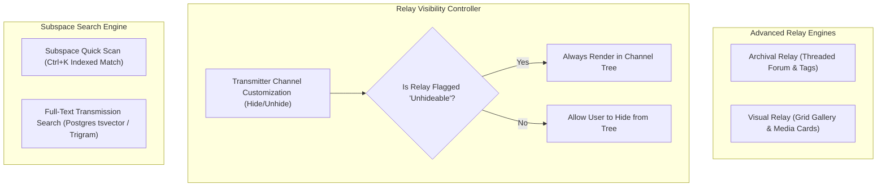

# Phase 8: Archival, Visual Relays & Subspace Search

## 1. Overview & Objective
Phase 8 expands the relay channel taxonomy beyond text and audio into **Archival Relays** (threaded forums) and **Visual Relays** (media galleries). It also delivers advanced channel visibility management (hideable relays, "All Relays" tab, unhideable flags) and the high-performance **Subspace Quick Scan** (`Ctrl+K`) global search engine.

---

## 2. Architectural Blueprint

---

## 3. Detailed Component Specifications

### 3.1 Archival Relays (Forum Threads)
- **Threaded Architecture**: Root transmission acting as thread starter with title, tags, and follower subscriptions.
- **Nested Responses**: Comment stream within the thread keeping discussions organized and searchable.
- **Pinning & Locking**: Clearances with `MANAGE_RELAYS` can pin important archives or lock threads.

### 3.2 Visual Relays (Media Galleries)
- **Media-First Grid**: Optimized layout for image and video broadcasting.
- **Visual Card View**: Generates responsive thumbnails, aspect ratio preservation, and lightbox fullscreen viewers with metadata displays.

### 3.3 Relay Visibility, "All Relays" Tab & Unhideable Relays
- **Hideable Relays**: Users can hide channels they don't frequent to keep their channel list tidy.
- **"All Relays" Tab**: Dedicated navigation tab displaying all accessible relays regardless of hidden state.
- **Channel Reordering**: To reorder channels in a Beacon, the user must check "Display all channels" in the Beacon context menu.
- **"Unhideable" Override Flag**: Beacon administrators can designate critical relays (e.g. `#announcements`, `#rules`) as **unhideable**. Unhideable relays remain permanently visible in the channel list for anyone with permission.

### 3.4 Subspace Quick Scan (`Ctrl+K`) & Deep Search
- **Quick Scan (`Ctrl+K`)**: Rapid in-memory/indexed fuzzy search across Beacons, Relays, and Transmitters that the current user belongs to (strictly scoped to user's memberships).
- **Deep Full-Text Transmission Search**: PostgreSQL `tsvector` indexed search across transmissions with filters for author, relay, date range, and attachments.

---

## 4. Deliverables Matrix

| Deliverable | Description | File Path |
| :--- | :--- | :--- |
| **Archival DB Schema** | Models for threads, tags, and subscriptions | `packages/database/src/schema/threads.ts` |
| **Archival API Routes**| Thread CRUD, comments, pins, locks | `apps/api-service/src/modules/threads/threads.routes.ts` |
| **Visual Relay Engine**| Media indexing and gallery grid routes | `apps/api-service/src/modules/gallery/gallery.routes.ts` |
| **Relay Visibility** | Channel reordering, hide preferences, unhideable flag | `apps/api-service/src/modules/relays/visibility.ts` |
| **Quick Scan API** | Scoped `Ctrl+K` rapid autocomplete endpoint | `apps/api-service/src/modules/search/quick-scan.ts` |
| **Full-Text Search** | PostgreSQL full-text transmission search | `apps/api-service/src/modules/search/deep-search.ts` |

---

## 5. Verification & Acceptance Criteria

### Automated Verification
1. **Thread Lifecycle Test**:
   - Create archival thread with tags $\to$ post comments $\to$ pin thread $\to$ lock thread $\to$ verify non-staff cannot post to locked thread.
2. **Unhideable Channel Test**:
   - User hides relay $\to$ succeeds.
   - Admin sets `is_unhideable: true` $\to$ user's hidden state is overridden in channel list query.
3. **Quick Scan Scoping Test**:
   - Transmitter searches for a private relay in a Beacon they are NOT in $\to$ returns 0 results.
   - Transmitter searches for a relay in their joined Beacon $\to$ returns matching result.

### Manual Acceptance Verification
- Open Archival relay, create thread, post reply; open Visual relay, upload pictures and test lightbox viewer; hit `Ctrl+K` and test instant navigation.
