# Phase 9: Command Console, Moderation & Commendations

## 1. Overview & Objective
Phase 9 delivers the operational oversight and achievement mechanisms of Subspace Frequency. It implements the **Command Console** (staff admin dashboard), a multi-tier incident reporting and review workflow, granular staff clearance ranks, and the event-driven **Badge Worker Service** powered by Redis Streams that automatically awards **Commendations** (badges).

---

## 2. Architectural Blueprint

```mermaid
flowchart TD
    subgraph ClientReporting["Incident Reporting Flow"]
        Transmitter["Transmitter Client"] -->|Context Menu: Report| FlareAPI["POST /reports (Incident Flare)"]
        FlareAPI --> AttachMsg["Attach Specific Message IDs as Evidence"]
        AttachMsg --> ReportQueue[(PostgreSQL reports)]
    end

    subgraph StaffConsole["Command Console (Admin Dashboard)"]
        StaffUser["Staff Transmitter"] --> AuthStaff["Check Command Clearance Rank"]
        AuthStaff --> ReviewQueue["Review Reports / Resolve / Ban / Quarantine Files"]
        AuthStaff --> BadgeAdmin["Configure Commendation Criteria Rules"]
    end

    subgraph EventWorker["Badge Worker (Redis Streams)"]
        Events["Gateway / API Events (transmission.sent, voice.ended, account.created)"] --> Stream["Redis Stream: telemetry:events"]
        Stream --> Worker["apps/badge-worker Consumer"]
        Worker --> CheckRules["Evaluate Progress against Criteria"]
        CheckRules --> Award["Award Commendation in DB & Notify WS"]
    end
```

---

## 3. Detailed Component Specifications

### 3.1 Incident Flare (Context Menu Reporting System)
- Users can open an incident flare on:
  1. A specific **Transmitter** (harassment, spam).
  2. A **Beacon** (inappropriate public listing, ToS violation).
  3. A specific **Transmission** (direct attachment of message ID and snapshot content to prevent tampering via message deletion).
- Staff can inspect original message snapshots in the report resolution UI.

### 3.2 Command Console & Staff Clearance Hierarchy
- **Dedicated Staff Rank System**: Separate from Beacon clearances; controls platform-wide administration.
- **Console Modules**:
  - Reports Queue: Assign, investigate, resolve, dismiss, or action violations.
  - User Directory: Inspect accounts, suspend, terminate, view active sessions.
  - File Vault Inspector: Audit uploaded files, quarantine malicious content.
  - Discovery Moderation: Review and delist offensive discoverable Beacons.
- **Mandatory Staff Commendation**: Automatically displayed on instance staff members' profiles.

### 3.3 Event-Driven Badge Worker Service (`apps/badge-worker`)
- Built on **Redis Streams** (`XADD` / `XREADGROUP`) for decoupled, fault-tolerant event processing.
- Listens to system events:
  - `account_created` (evaluates account age milestones: 1 month, 6 months, 1 year).
  - `comm_link.ended` (aggregates total voice call minutes).
  - `holo_cast.ended` (aggregates total screensharing minutes).
  - `transmission.sent` (aggregates message counts).
- Evaluates rules configured by administrators in the Command Console and automatically awards Commendations upon reaching thresholds.
- Transmitters can reorder their commendation display or toggle visibility on their public profile.

---

## 4. Deliverables Matrix

| Deliverable | Description | File Path |
| :--- | :--- | :--- |
| **Moderation Schemas**| DB models for reports, reported messages, staff actions | `packages/database/src/schema/reports.ts` |
| **Commendation Schemas**| DB models for badges, criteria, user progress | `packages/database/src/schema/commendations.ts` |
| **Staff Rank Schemas**| Instance staff permissions and clearances | `packages/database/src/schema/staff.ts` |
| **Report API Routes** | Submit report, staff list, resolve, action | `apps/api-service/src/modules/reports/reports.routes.ts` |
| **Admin API Routes**  | Command Console staff management APIs | `apps/api-service/src/modules/admin/admin.routes.ts` |
| **Badge Worker**      | Redis Streams event consumer & criteria evaluator | `apps/badge-worker/src/index.ts` |

---

## 5. Verification & Acceptance Criteria

### Automated Verification
1. **Report Submission & Evidence Preservation Test**:
   - User submits report attaching transmission ID $\to$ original transmission author deletes the message $\to$ report ticket retains frozen message snapshot.
2. **Staff Rank Authorization Test**:
   - Non-staff attempts access to `/admin` $\to$ returns `403 FORBIDDEN_STAFF_REQUIRED`.
   - Junior staff attempts to ban Senior staff $\to$ blocked by staff rank hierarchy.
3. **Badge Worker Redis Stream Test**:
   - Publish mock `voice.session_ended` event (duration: 3600 seconds) to Redis Stream.
   - Badge worker consumes event, increments minutes, and awards "1 Hour Comm-Link" commendation.

### Manual Acceptance Verification
- File a report via context menu, open the Command Console in an admin session, review the evidence, resolve the ticket, and check the automated badge grant in user profile.
