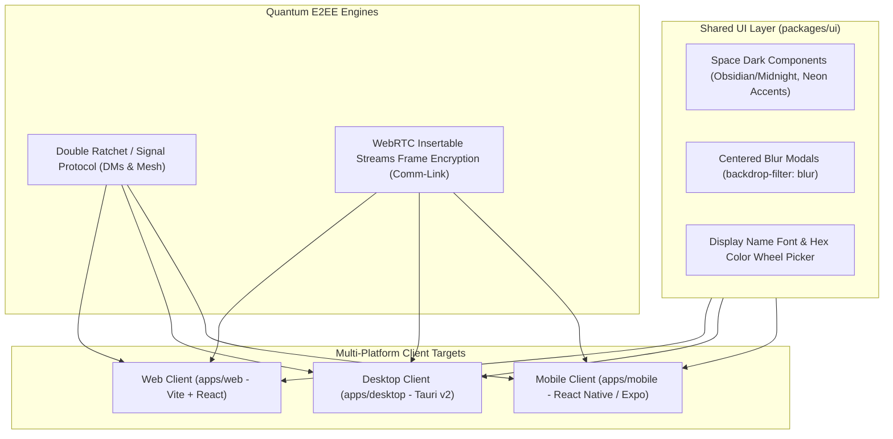

# Phase 10: Multi-Platform Clients & Quantum E2EE

## 1. Overview & Objective
Phase 10 delivers the complete client-facing experience and end-to-end encryption layers of Subspace Frequency. It produces the **Web Client**, **Tauri Desktop Client** (Windows, macOS, Linux - no Electron), and **React Native Mobile Client** (iOS/Android), all sharing a unified, space-themed dark modern UI. It also delivers toggleable **Quantum Encryption** for Direct Messages (via Double Ratchet) and Voice/Video (via LiveKit WebRTC Insertable Streams).

---

## 2. Architectural Blueprint

---

## 3. Detailed Component Specifications

### 3.1 Space Dark Design System & Styling (`packages/ui`)
- **Theme**: Strictly **Pure Dark Mode**. Deep obsidian background (`#0B0E14`), midnight blue card surfaces (`#151922`), glowing cyan (`#00F0FF`) and violet accents.
- **Modals**: Centered popup dialogs with rounded corners (`rounded-2xl`) and frosted glass dark backdrops (`backdrop-blur-md bg-black/60`).
- **Profile Customization**:
  - Customizable banner: hex color or uploaded banner image.
  - Display name font selector: curated list of clean futuristic and legible sans-serif fonts.
  - Display name color: interactive color wheel picker with hex input.

### 3.2 Multi-Platform Clients (No Electron!)
- **Web App (`apps/web`)**: Ultra-fast Vite + React SPA with optimistic UI updates.
- **Desktop App (`apps/desktop`)**: **Tauri v2** shell (Rust backend + Web frontend) compiling tiny native binaries for Windows (`.msi`/`.exe`), macOS (`.dmg`), and Linux (`.AppImage`/`.deb`).
- **Mobile App (`apps/mobile`)**: React Native / Expo application shell providing native push notifications, mobile audio background sessions, and haptic feedback.

### 3.3 Quantum Encryption (End-to-End Encryption)
- **Transmission Quantum E2EE (DMs & Mesh)**:
  - Built with Double Ratchet / Signal Protocol algorithms (`@signalapp/libsignal-client` or MLS).
  - Keys generated on client device and stored in secure device storage (Keychain / DPAPI / Keystore).
  - Server stores only encrypted ciphertexts; cannot read transmission content.
- **Comm-Link Quantum E2EE (Audio/Video/Screenshare)**:
  - Leverages LiveKit WebRTC **Insertable Streams** encryption.
  - Real-time frame payloads encrypted with shared participant room keys before leaving the browser/client, decryptable only by room participants.

---

## 4. Deliverables Matrix

| Deliverable | Description | File Path |
| :--- | :--- | :--- |
| **Shared Design System**| Dark space components, modals, color wheel, fonts | `packages/ui/src/index.ts` |
| **Web Client**        | React + Vite web SPA | `apps/web/src/App.tsx` |
| **Desktop Client**    | Tauri v2 desktop application shell | `apps/desktop/src-tauri/src/main.rs` |
| **Mobile Client**     | React Native / Expo mobile application | `apps/mobile/src/App.tsx` |
| **Double Ratchet**    | Client-side Signal Protocol DM encryption engine | `packages/crypto/src/double-ratchet.ts` |
| **LiveKit E2EE**      | WebRTC frame encryption worker and key management | `packages/crypto/src/livekit-e2ee.ts` |

---

## 5. Verification & Acceptance Criteria

### Automated Verification
1. **Double Ratchet Cryptographic Test**:
   - Alice encrypts transmission to Bob $\to$ server validates payload is raw ciphertext $\to$ Bob decrypts back to original plaintext $\to$ Third party cannot decrypt without ratchet session state.
2. **Build Verification Tests**:
   - Web client compiles with Vite: `pnpm --filter @subspace/web build`.
   - Desktop client compiles via Tauri CLI: `cargo check` in `apps/desktop/src-tauri`.
   - Mobile TypeScript bundle passes checks: `pnpm --filter @subspace/mobile typecheck`.

### Manual Acceptance Verification
- Launch Desktop Tauri app on Windows, log in, send encrypted transmission to Mobile app, verify message appears instantly, and start an encrypted Comm-Link audio call.
