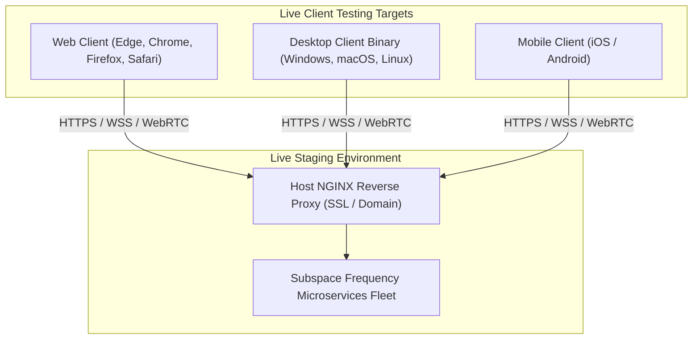

# Phase 11: Live Environment Client Verification & Deployment

## 1. Overview & Objective
Phase 11 focuses on deploying the Subspace Frequency stack to a live staging environment, verifying the multi-platform clients (Web, Desktop, Mobile) against live services, conducting real-world load/concurrency tests, and validating end-to-end user workflows in a non-mocked networked environment. Hosting configuration details for the live staging system will be provided by the user when entering this phase.

---

## 2. Architectural Blueprint

---

## 3. Detailed Component Specifications

### 3.1 Live Staging Deployment & Domain Configuration
- Base testing domain: **`subspace.click`**.
- Host NGINX reverse proxy will route incoming traffic for:
  - `subspace.click` / `app.subspace.click` $\to$ Web Client (Port 3000)
  - `api.subspace.click` $\to$ REST API (Port 3001)
  - `gateway.subspace.click` $\to$ WebSocket Gateway (Port 3002)
  - `vault.subspace.click` $\to$ Subspace Vault File API (Port 3003)
  - `s3.subspace.click` $\to$ MinIO Object Storage (Port 9000)
  - `storage.subspace.click` $\to$ MinIO Console (Port 9001)
  - `livekit.subspace.click` $\to$ LiveKit SFU (Port 7880)
  - `docs.subspace.click` $\to$ Docs Site (Port 4000)
- Production SSL certificate termination on host NGINX with automatic HTTPS redirection.
- Strict firewall and internal container network verification ensuring zero internal database or Redis ports leak to public interfaces.

### 3.2 Live Multi-Platform Verification
- **Cross-Browser Verification**: Responsive UI rendering, WebSocket connection stability, WebRTC media connectivity across Chrome, Firefox, Safari, and Edge.
- **Desktop Client Verification**: Install and test native Tauri installers on Windows (`.msi`), Linux (`.deb` / `.AppImage`), and macOS (`.dmg`). Verify OS notification badges and deep linking (`subspace://` protocol).
- **Mobile Client Verification**: Test layout responsiveness, virtual keyboard avoidance, push notifications, and background audio session stability.

### 3.3 End-to-End Live Workflow Testing
- Real-time multi-user voice and screenshare sessions with simulated network latency and packet loss.
- Simultaneous transmission stress testing across active relays.
- Verification of live file uploads to S3 MinIO storage through the reverse proxy.

---

## 4. Deliverables Matrix

| Deliverable | Description | File Path |
| :--- | :--- | :--- |
| **Staging Compose** | Production-hardened container compose profile | `docker-compose.staging.yml` |
| **Live Verification Report**| Cross-client testing results and telemetry log | `docs/testing/live-environment-report.md` |
| **Desktop Installers** | Packaged binaries for Windows, macOS, and Linux | `apps/desktop/target/release/bundle` |
| **E2E Live Test Suite**| Playwright / native integration test runner against live URL | `tests/live-e2e` |

---

## 5. Verification & Acceptance Criteria

### Automated Verification
1. **Live Smoke Tests**:
   - Automated script hits live HTTPS health endpoint: `https://<domain>/api/health` $\to$ returns 200 OK.
   - WebSocket connection handshake over `wss://<domain>/gateway` establishes and authenticates.
   - LiveKit SFU signaling over `wss://<domain>/livekit` responds with valid room connection.

### Manual Acceptance Verification
- Open desktop client, web client, and mobile client connected simultaneously to live domain.
- Join a Comm-Link room, transmit audio/video, broadcast screenshare, and verify flawless synchronization across all three endpoints.
