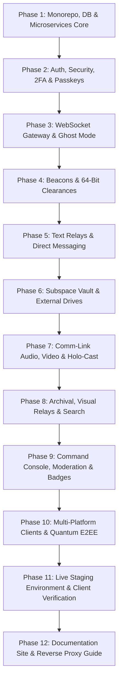

# Subspace Frequency - Feature Matrix, Master Roadmap & Deliverables Tracking

This document outlines the entire product scope, multi-phase technical implementation roadmap, architectural deliverables, and verification checklist for Subspace Frequency.

---

## 1. Complete Feature Matrix

| Feature Area | Specific Requirement | Subspace Frequency Terminology | Status | Deliverable Path |
| :--- | :--- | :--- | :--- | :--- |
| **Identity & Auth** | Username & Password (Argon2id) | Transmitter Credentials | Planned | `apps/api-service/src/modules/auth` |
| | Toggleable SMTP Email Verification | Transmitter Verification | Planned | `apps/api-service/src/modules/auth` |
| | Time-based One-Time Password (TOTP) | 2FA Security Protocol | Planned | `packages/crypto` |
| | Biometric / Hardware Key Passkeys | FIDO2 Passkeys | Planned | `packages/crypto` |
| | Instance Rules Acknowledgment Modal | Subspace Directives | Planned | `apps/api-service/src/modules/instance` |
| **Profiles & Presence** | Customizable Banner (Hex Color / Image) | Transmitter Banner | Planned | `packages/database/src/schema/transmitters.ts` |
| | Display Name Font Picker (Curated list) | Transmission Font | Planned | `packages/database/src/schema/transmitters.ts` |
| | Display Name Hex Color Wheel | Signal Color | Planned | `packages/database/src/schema/transmitters.ts` |
| | 5 Presence States (Online, Idle, Away, Invisible, Offline) | Presence Array | Planned | `apps/gateway-service` |
| | Ghost Mode (Mask invisible as offline) | Ghost Mode | Planned | `apps/gateway-service/src/presence.ts` |
| | Dynamic Commendations (Badges) | Commendations | Planned | `apps/badge-worker` |
| | Mandatory Staff Commendation | Command Staff Insignia | Planned | `packages/database/src/schema/commendations.ts` |
| | Reorder & Toggle Commendation Visibility | Commendation Deck | Planned | `apps/api-service/src/modules/commendations` |
| **Beacons (Servers)** | Beacon Creation & Customization | Beacon Hub | Planned | `apps/api-service/src/modules/beacons` |
| | Beacon Navigation Folders | Beacon Clusters | Planned | `packages/database/src/schema/beacons.ts` |
| | Hierarchical Clearances (Roles) | Clearances | Planned | `packages/database/src/schema/clearances.ts` |
| | 64-bit Bitfield Permissions | Signal Authorizations | Planned | `packages/constants/src/permissions.ts` |
| | Clearance Hierarchy Rules (Cannot edit higher/equal) | Hierarchy Protocol | Planned | `apps/api-service/src/middleware/clearance.ts` |
| | Role Promotion Delegation Config | Clearance Delegation | Planned | `packages/database/src/schema/clearances.ts` |
| | Clearance Color overrides display name color | Spectral Priority | Planned | `packages/ui` |
| | Beacon-level custom font suppression | Beacon Font Override | Planned | `packages/database/src/schema/beacons.ts` |
| | Server Onboarding & Rules Acceptance | Entry Quarantine & Protocol Agreement | Planned | `apps/api-service/src/modules/onboarding` |
| | Opt-in Beacon Discovery Directory | Subspace Beacon Index | Planned | `apps/api-service/src/modules/discovery` |
| **Relays (Channels)** | Frequency Bands (Channel Categories) | Frequency Bands | Planned | `packages/database/src/schema/relays.ts` |
| | Text Chat (2000-char instance configurable) | Text Relay | Planned | `apps/api-service/src/modules/transmissions` |
| | Audio/Video Comm-Link via LiveKit | Comm-Link Relay | Planned | `docker/livekit.yaml` |
| | Embedded Text Chat inside Comm-Link (no voice join needed) | Comm-Link Subchannel | Planned | `apps/web/src/components/relay/CommLink` |
| | Screensharing | Holo-Cast | Planned | `packages/ui/src/media/HoloCast` |
| | Forum Channels (Thread-based) | Archival Relay | Planned | `packages/database/src/schema/threads.ts` |
| | Media Grid Galleries | Visual Relay | Planned | `packages/database/src/schema/gallery.ts` |
| | Hideable Relays + "All Relays" Tab | Relay Frequency Filter | Planned | `apps/web/src/components/relay/RelayList` |
| | Unhideable Relay Override Flag | Core Priority Relay | Planned | `packages/database/src/schema/relays.ts` |
| | Custom Emojis | Signal Glyphs | Planned | `apps/api-service/src/modules/glyphs` |
| **Direct Messaging** | Point-to-Point 1-on-1 Chat | Point-to-Point Link | Planned | `apps/api-service/src/modules/links` |
| | Subspace Meshes (Group DMs) | Subspace Mesh | Planned | `apps/api-service/src/modules/mesh` |
| | Affiliation (Friend) Requests with Notes | Affiliation Request | Planned | `apps/api-service/src/modules/affiliations` |
| | 1-Message Transmission Requests (7-day timeout) | Transmission Request | Planned | `apps/api-service/src/modules/requests` |
| | User, Message, and Server Block Engine | Signal Blacklist | Planned | `apps/api-service/src/modules/blocks` |
| **Storage & Drive** | Subspace Vault (Personal file drive UI) | Subspace Vault | Planned | `apps/file-service` |
| | First-Time Upload Public Link Disclaimer | Quarantine Disclaimer | Planned | `packages/ui/src/modals/UploadDisclaimer` |
| | MinIO S3 Presigned Uploads & Downloads | Direct S3 Conduit | Planned | `apps/file-service/src/s3.ts` |
| | External Drive (OneDrive, GDrive, Dropbox) Picker | External Cloud Tether | Planned | `apps/file-service/src/integrations` |
| | External URL Unfurling & Inline Preview | Transmission Unfurler | Planned | `apps/api-service/src/modules/unfurl` |
| **Moderation & Admin**| Context Menu "Report Message / User / Beacon" | Incident Flare | Planned | `apps/api-service/src/modules/reports` |
| | Command Console (Admin Dashboard) | Command Console | Planned | `apps/web/src/views/CommandConsole` |
| | Staff Rank Permissions Engine | Command Clearance System | Planned | `packages/database/src/schema/staff.ts` |
| | Custom Commendation Rules Builder | Insignia Forge | Planned | `apps/badge-worker/src/evaluator.ts` |
| **Search & Discovery**| Global Quick Find (`Ctrl+K`) | Subspace Quick Scan | Planned | `apps/api-service/src/modules/search` |
| | Full-Text Transmission Search | Subspace Deep Search | Planned | `apps/api-service/src/modules/transmissions/search.ts` |
| **Security & Privacy**| LiveKit WebRTC E2EE (Insertable Streams) | Comm-Link Quantum Encryption | Planned | `packages/crypto/src/livekit-e2ee.ts` |
| | Double Ratchet / Signal DM Encryption | Point-to-Point Quantum Encryption | Planned | `packages/crypto/src/double-ratchet.ts` |
| **Clients & Design** | Shared React + React Native Web UI | Space Dark Theme Design System | Planned | `packages/ui` |
| | Desktop App (Windows, Mac, Linux) | Tauri Shell | Planned | `apps/desktop` |
| | Web App | Vite SPA | Planned | `apps/web` |
| | Mobile App | Expo / React Native Shell | Planned | `apps/mobile` |
| **Quality & Testing**| Automated Docker E2E API & WebSocket Test Harness | Vitest Test Matrix | Planned | `tests/e2e` |

---

## 2. 12-Phase Implementation Roadmap

Breaking down the system into **12 focused, risk-managed phases** ensures that every subsystem receives thorough architecture, validation, and zero bloated PRs.

> [!IMPORTANT]
> **Single-Phase Execution Rule**: Only **one** phase will be executed at a time. No new phase will be started without explicit user review and consent.

---

## 3. Detailed 10-Phase Breakdown & Deliverables

### Phase 1: Monorepo Foundation & Microservices Infrastructure
- **Detailed Specification**: [docs/phases/phase-01-foundation.md](file:///c:/Users/Jackson%20Abney/subspace-frequency/docs/phases/phase-01-foundation.md)
- **Focus**: Repo orchestration, database schemas, Docker topology, base tooling.
- **Deliverables**:
  - `pnpm-workspace.yaml`, `turbo.json`, root `package.json`
  - `docker-compose.yml` (Postgres 16, Redis 7, MinIO, LiveKit, Fastify API, Gateway, Badge Worker, File Service)
  - `docker-compose.test.yml` (Automated testing container)
  - `packages/database`: Drizzle ORM base schema models for Transmitters, Beacons, Relays, Clearances, Transmissions
  - `packages/constants`: Terminology constants, bitfield flags, presence status enums
- **Verification**: Containers spin up healthy via `docker compose up -d`, Drizzle schema migrations execute cleanly.

### Phase 2: Authentication, Security, 2FA & Passkeys
- **Focus**: Multi-factor authentication, instance rules agreement, and identity security.
- **Deliverables**:
  - `packages/crypto`: Argon2id password hashing, SimpleWebAuthn FIDO2 passkey verification, TOTP 2FA engine
  - `apps/api-service/src/modules/auth`: Register, login, 2FA setup/verify, passkey register/verify
  - Configurable SMTP email verification toggle
  - Instance Rules acknowledgment modal check (TL;DR ToS acceptance gate before granting session tokens)
- **Verification**: E2E tests for registration, login, passkey challenges, 2FA token validation, and rule agreement enforcement.

### Phase 3: Real-Time Gateway & Ghost Mode Presence
- **Focus**: WebSocket connection lifecycle, heartbeats, real-time presence, and stealth privacy.
- **Deliverables**:
  - `apps/gateway-service`: WebSocket server (ws), heartbeat ping/pong, JWT connection handshake
  - Redis Pub/Sub integration for gateway clustering and multi-node event fanout
  - 5 Presence States: `online`, `idle`, `away`, `invisible`, `offline`
  - **Ghost Mode Engine**: Server-side masking converting `invisible` directly to `offline` for all peer broadcasts
- **Verification**: Dual-client E2E test verifying that when Client A switches to `invisible`, Client B strictly receives `offline`.

### Phase 4: Beacons, Beacon Clusters & Clearances
- **Focus**: Server hierarchy, 64-bit Bitfield security, channel categories, and discovery.
- **Deliverables**:
  - `apps/api-service/src/modules/beacons`: Beacon creation, icon/banner upload, Beacon Clusters (folders)
  - `apps/api-service/src/modules/clearances`: 64-bit Bitfield permissions (`PERMISSIONS.ADMINISTRATOR`, etc.)
  - **Hierarchy Protocol**: Middleware enforcing that Transmitters cannot edit, kick, ban, or delete transmissions of users with equal or higher clearance position
  - Beacon Onboarding: Rules acceptance gate & self-assignable role selection
  - Beacon Discovery Index: Opt-in public directory with dedicated reporting
- **Verification**: Hierarchy tests confirming position 2 role cannot modify position 3 role.

### Phase 5: Text Relays & Direct Messaging (P2P / Mesh)
- **Focus**: Core messaging, message requests, and social connections.
- **Deliverables**:
  - `apps/api-service/src/modules/transmissions`: 2000-char text chat, markdown, mentions, signal glyphs (custom emojis)
  - `apps/api-service/src/modules/links`: 1-on-1 Point-to-Point links (DMs)
  - `apps/api-service/src/modules/mesh`: Subspace Meshes (Group DMs)
  - `apps/api-service/src/modules/requests`: Transmission Requests (1 message limit, 7-day expiration, mutual beacon requirement)
  - `apps/api-service/src/modules/affiliations`: Affiliation Requests with optional intro note
  - User, message, and beacon blocking (Signal Blacklist)
- **Verification**: Message request expires at 7 days; non-affiliated user blocked after 1 message until accepted.

### Phase 6: Subspace Vault (Storage) & Cloud Integrations
- **Focus**: S3 file storage, personal drive quotas, and external cloud tethers.
- **Deliverables**:
  - `apps/file-service`: Presigned upload/download URL generation for MinIO S3
  - **Quarantine Disclaimer**: Mandatory first-time upload modal warning about direct public link access
  - Subspace Vault UI: Personal storage quota tracker and file explorer
  - External Cloud Drive Tethers: OneDrive, Google Drive, and Dropbox OAuth2 file picker
  - Transmission Unfurler: Metadata scraping for rich inline file previews
- **Verification**: Direct upload via presigned S3 URL succeeds; upload blocked if disclaimer not accepted.

### Phase 7: Comm-Link Audio, Video & Holo-Cast [COMPLETED]
- **Focus**: Real-time voice/video streaming, screensharing, and embedded text chats.
- **Deliverables**:
  - `docker/livekit.yaml` + LiveKit SFU server configuration
  - `apps/api-service/src/modules/media`: LiveKit room token generation and participant authentication
  - Comm-Link Relay: Opus audio and VP8/H.264 video pipelines
  - Holo-Cast: High-framerate screensharing with audio capture
  - **Embedded Text Subchannel**: Integrated text chat accessible without joining the voice room
- **Verification**: Multi-participant voice session joins, token issuance, and voice text subchannel transmission tests.

### Phase 8: Archival, Visual Relays & Subspace Search
- **Focus**: Specialized relay types, channel management, and full-text search.
- **Deliverables**:
  - Archival Relays (Forum): Structured thread discussions, tags, and pinned root posts
  - Visual Relays (Gallery): Media-first grid layout for images and videos
  - Channel Visibility: Hideable relays, "All Relays" tab, and unhideable channel overrides
  - Subspace Quick Scan (`Ctrl+K`): Global quick find across joined Beacons, Relays, and Transmitters
  - Deep Full-Text Transmission Search with date, user, and relay filters
- **Verification**: Threads create and nest correctly; unhideable relays remain visible even when user filters relays.

### Phase 9: Command Console, Moderation & Commendations
- **Focus**: Instance administration, incident reports, and automated badge worker.
- **Deliverables**:
  - Command Console: Staff dashboard for reports, user bans, drive file audits, and server discovery moderation
  - Staff Clearance Hierarchy: Granular staff permissions
  - Incident Flare: Context menu report flow attaching message IDs and telemetry
  - `apps/badge-worker`: Redis Streams consumer tracking account age, voice call minutes, screenshare minutes, and transmissions sent
  - Commendation Deck: Reordering and visibility toggles on Transmitter profile
  - Mandatory Command Staff Insignia
- **Verification**: Redis Streams event fires when voice call ends; badge worker awards commendation once duration threshold is met.

### Phase 10: Multi-Platform Clients & Quantum E2EE
- **Detailed Specification**: [docs/phases/phase-10-clients-quantum-e2ee.md](file:///c:/Users/Jackson%20Abney/subspace-frequency/docs/phases/phase-10-clients-quantum-e2ee.md)
- **Focus**: Cross-platform client applications, dark theme system, and end-to-end encryption.
- **Deliverables**:
  - `packages/ui`: Pure dark space theme (obsidian, midnight blue, cyan/violet accents), centered blur modals, color wheel picker, font selector
  - `apps/web`: Vite + React single-page app
  - `apps/desktop`: Tauri v2 application shell for Windows, macOS, and Linux
  - `apps/mobile`: React Native / Expo cross-platform mobile app
  - **Point-to-Point Quantum Encryption**: Double Ratchet / Signal Protocol for 1-on-1 and Mesh DMs
  - **Comm-Link Quantum Encryption**: LiveKit WebRTC Insertable Streams frame encryption
- **Verification**: Desktop and mobile build targets compile; message ciphertexts stored without private keys on server.

### Phase 11: Live Staging Environment & Client Verification
- **Detailed Specification**: [docs/phases/phase-11-live-verification.md](file:///c:/Users/Jackson%20Abney/subspace-frequency/docs/phases/phase-11-live-verification.md)
- **Focus**: Live staging deployment, multi-platform client live network testing, load verification.
- **Deliverables**:
  - `docker-compose.staging.yml`: Production-hardened container compose profile
  - Staging host NGINX reverse proxy configuration with SSL termination
  - Real-world multi-client concurrency tests across Web, Desktop, and Mobile
  - Live media latency and screensharing verification
- **Verification**: All three client targets interact seamlessly over live network with zero leaked ports.

### Phase 12: Documentation Site & Reverse Proxy Guide
- **Detailed Specification**: [docs/phases/phase-12-documentation-site.md](file:///c:/Users/Jackson%20Abney/subspace-frequency/docs/phases/phase-12-documentation-site.md)
- **Focus**: Full-featured static documentation site, deployment manual, host NGINX reverse proxy recipes.
- **Deliverables**:
  - `apps/docs`: Searchable static docs site (Astro Starlight / VitePress)
  - `deploy/nginx/subspace.conf`: Ready-to-use host NGINX reverse proxy configuration for systems with pre-existing port 80/443 setups
  - Complete operator manuals for Docker backups, custom rules, and Commendations configuration
- **Verification**: Docs site compiles statically with zero broken links and passes NGINX syntax validation.

---

## 4. Master Deliverables Checklist

- [x] **Phase 1: Monorepo Foundation & Microservices Infrastructure** ([phase-01-foundation.md](file:///c:/Users/Jackson%20Abney/subspace-frequency/docs/phases/phase-01-foundation.md))
  - [x] `docs/terminology.md`
  - [x] `docs/architecture.md`
  - [x] `docs/roadmap.md`
  - [x] `docs/phases/phase-01-foundation.md`
  - [x] `pnpm-workspace.yaml`, `turbo.json`, `package.json`
  - [x] `docker-compose.yml` (Postgres, Redis, MinIO, LiveKit, Services)
  - [x] `packages/database` (Drizzle ORM base models)
  - [x] `packages/constants` (Permissions, presence, terminology)
  - [x] `docker-compose.test.yml` (Vitest test cluster)
- [x] **Phase 2: Authentication, Security, 2FA & Passkeys** ([phase-02-auth-security.md](file:///c:/Users/Jackson%20Abney/subspace-frequency/docs/phases/phase-02-auth-security.md))
  - [x] `packages/crypto` (Argon2id, WebAuthn, TOTP)
  - [x] `apps/api-service/src/modules/auth` (Register, Login, Session)
  - [x] 2FA TOTP setup & verification endpoints
  - [x] FIDO2 Passkey registration & challenge verification
  - [x] Instance Rules agreement gate
- [x] **Phase 3: Real-Time Gateway & Ghost Mode Presence** ([phase-03-gateway-presence.md](file:///c:/Users/Jackson%20Abney/subspace-frequency/docs/phases/phase-03-gateway-presence.md))
  - [x] `apps/gateway-service` (WebSocket server, heartbeats)
  - [x] Redis Pub/Sub gateway event bus
  - [x] 5 Presence states with Ghost Mode offline masking
  - [x] Gateway connection auth handshake
- [x] **Phase 4: Beacons, Beacon Clusters & Clearances** ([phase-04-beacons-clearances.md](file:///c:/Users/Jackson%20Abney/subspace-frequency/docs/phases/phase-04-beacons-clearances.md))
  - [x] `apps/api-service/src/modules/beacons` (Beacon CRUD, Clusters)
  - [x] 64-bit Bitfield permissions calculator
  - [x] Clearance hierarchy validator (prevent higher/equal modifications)
  - [x] Beacon onboarding rules agreement & role picker
  - [x] Opt-in Beacon discovery directory
- [x] **Phase 5: Text Relays & Direct Messaging (P2P / Mesh)** ([phase-05-text-relays-messaging.md](file:///c:/Users/Jackson%20Abney/subspace-frequency/docs/phases/phase-05-text-relays-messaging.md))
  - [x] `apps/api-service/src/modules/transmissions` (Text relay chat, 2000 char limit)
  - [x] Point-to-Point links (1-on-1 DMs)
  - [x] Subspace Meshes (Group DMs)
  - [x] Transmission requests (1 message, 7-day expiration)
  - [x] Affiliation requests with note transmission
  - [x] User, message, and beacon block system
- [x] **Phase 6: Subspace Vault (Storage) & Cloud Integrations** ([phase-06-subspace-vault-storage.md](file:///c:/Users/Jackson%20Abney/subspace-frequency/docs/phases/phase-06-subspace-vault-storage.md))
  - [x] `apps/file-service` (MinIO S3 presigned URL engine)
  - [x] Quarantine disclaimer compliance modal
  - [x] Subspace Vault drive UI & quota management
  - [x] OneDrive, Google Drive, Dropbox OAuth2 picker
  - [x] Transmission unfurler metadata previewer
- [ ] **Phase 7: Comm-Link Audio, Video & Holo-Cast** ([phase-07-comm-link-holocast.md](file:///c:/Users/Jackson%20Abney/subspace-frequency/docs/phases/phase-07-comm-link-holocast.md))
  - [ ] `docker/livekit.yaml` + SFU server setup
  - [ ] Comm-Link token generation & room management
  - [ ] Audio/video publishing and subscribing
  - [ ] Holo-Cast screenshare pipeline
  - [ ] Embedded text subchannel inside Comm-Link
- [ ] **Phase 8: Archival, Visual Relays & Subspace Search** ([phase-08-archival-visual-search.md](file:///c:/Users/Jackson%20Abney/subspace-frequency/docs/phases/phase-08-archival-visual-search.md))
  - [ ] Archival Relays (Forum threads & tags)
  - [ ] Visual Relays (Gallery grid)
  - [ ] Hideable relays, "All Relays" tab, and unhideable overrides
  - [ ] Subspace Quick Scan (`Ctrl+K`)
  - [ ] Full-text transmission search
- [ ] **Phase 9: Command Console, Moderation & Commendations** ([phase-09-command-console-badges.md](file:///c:/Users/Jackson%20Abney/subspace-frequency/docs/phases/phase-09-command-console-badges.md))
  - [ ] Command Console staff management dashboard
  - [ ] Staff rank clearance hierarchy
  - [ ] Incident flare reports & moderation queue
  - [ ] `apps/badge-worker` Redis Streams consumer
  - [ ] Commendation deck reordering & visibility controls
  - [ ] Mandatory Command Staff Insignia
- [ ] **Phase 10: Multi-Platform Clients & Quantum E2EE** ([phase-10-clients-quantum-e2ee.md](file:///c:/Users/Jackson%20Abney/subspace-frequency/docs/phases/phase-10-clients-quantum-e2ee.md))
  - [ ] `packages/ui` Pure Dark Space Theme & Components
  - [ ] `apps/web` Web Client (Vite)
  - [ ] `apps/desktop` Tauri v2 Desktop Client (Windows, Mac, Linux)
  - [ ] `apps/mobile` React Native / Expo Mobile Client
  - [ ] Double Ratchet Transmission Quantum Encryption
  - [ ] LiveKit WebRTC Insertable Streams Quantum Encryption
- [ ] **Phase 11: Live Staging Environment & Client Verification** ([phase-11-live-verification.md](file:///c:/Users/Jackson%20Abney/subspace-frequency/docs/phases/phase-11-live-verification.md))
  - [ ] `docker-compose.staging.yml`
  - [ ] Staging host NGINX reverse proxy configuration
  - [ ] Cross-client live integration testing report
  - [ ] Live audio, video & screenshare verification
- [ ] **Phase 12: Production Documentation Site & Setup Guide** ([phase-12-documentation-site.md](file:///c:/Users/Jackson%20Abney/subspace-frequency/docs/phases/phase-12-documentation-site.md))
  - [ ] `apps/docs` (Searchable static docs site)
  - [ ] `deploy/nginx/subspace.conf` (Host NGINX reverse proxy template for `subspace.click`)
  - [ ] Operator manual & backup guides
  - [ ] Host ports 80 & 443 integration guide
  - [ ] **Clean Slate Rebuild**: Full wipe of live test environment and re-setup strictly following documentation ([clean-slate-rebuild.md](file:///c:/Users/Jackson%20Abney/subspace-frequency/docs/testing/clean-slate-rebuild.md))

